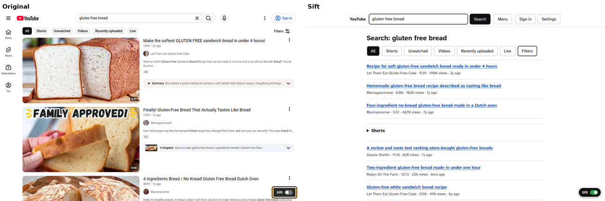

# Sift

A Chrome extension that turns any website into its essence: only the information and controls that matter, on a clean white page, still fully usable. Built for everyone, and especially for people for whom cluttered websites are a real barrier: low vision, ADHD, dyslexia, older users.

Install page: https://sift.pujia.ar

YouTube search, original and sifted:



A BBC article, original and sifted:


## What it does

- Every page opens already sifted. One switch (bottom right corner, the toolbar button, or `Alt+Shift+S`) shows the original page. Switching to the original lasts for the rest of the tab's visit to that site.
- Removes ads, popups, banners, navigation clutter, share buttons, promos, and decoration.
- Shortens text: long articles get a "Short version" written by a language model, with the full text one click away. Lists get a plain one-line description per entry (YouTube videos, Amazon products, long headlines), while names (channels, playlists) stay as they are; emails get a one-line gist.
- Keeps everything you need to act: search, links, buttons, forms, video. Every action is replayed on the original page, so it has the same effect.
- Tool pages (maps, players, editors) keep their working surface inside Sift's view.
- Keeps the page's language. White, high contrast, large type (Atkinson Hyperlegible Next), keyboard and screen reader friendly.

## How it works

- `src/content/index.ts` runs at `document_start`. It puts Sift's root in the browser's top layer (a manual popover) so the original never flashes, then extracts and renders the page, and re-extracts when the page changes (mutations, single-page navigation, infinite lists).
- `src/content/extract/generic.ts` turns any DOM into Sift's page model (`src/content/model.ts`): headings, paragraphs, lists of items, forms, actions, articles, and portals.
- `src/content/adapters/` has site adapters for YouTube, Amazon, and Gmail. They return `null` to fall back to the generic extractor.
- `src/content/proxy.ts` replays clicks, typing, selects, files, and submits on the original elements with realistic event sequences.
- `src/content/portal.ts` shows an original element (a video player, a map, a payment field) inside Sift's layout by lifting it into the top layer over a placeholder. It never moves in the DOM, so the site keeps working.
- `src/content/shield.ts` keeps the original page alive but `inert` while Sift is shown.
- `src/background/index.ts` calls the model (OpenAI-compatible API, OpenRouter by default), streams results, and caches them in IndexedDB per site. Each task tries a chain: its measured main model, a fallback, then a last resort routed through the owner's own OpenAI key, so an out-of-credit account still works; a 402 retries once with a smaller budget, and Sift says so when every model refuses. Model choices are measured in `research/llm-bench.md`.

## Develop

```bash
bun install
bun run build          # builds dist/
./scripts/chrome.sh start   # test Chrome with Sift, debug port 9444 (tmux window sift:chrome)
./scripts/chrome.sh reload  # reinstall dist/ after a build
```

Test scripts (all use the test Chrome):

- `bun scripts/visit.ts <url> <name>`: load a page, save a screenshot and Sift's outline to `research/shots/`.
- `bun scripts/act.ts click:<text> type:<css>=><text> press:Enter ...`: drive Sift with real input.
- `bun scripts/a11y.ts <url>`: axe-core audit of Sift's view.
- `bun scripts/tabwalk.ts <url>`: where keyboard focus goes.
- `bun scripts/profile.ts <url>`: CPU profile of extraction.
- `bun scripts/firstpaint.ts <url> <selector> [runs] [--sift css] [--block amazon]`: time to first content, the original (Sift off) against Sift, `runs` per side, in alternating loads of one tab. A probe injected before the page's scripts checks every animation frame, so a busy main thread cannot hide time; it prints each run (with FCP and long tasks) and the medians, and puts the tab's Sift setting back as it was. `--sift li.item` waits for Sift's list where the selector is a list entry. `--block amazon` keeps the Amazon snapshots and fixtures from reaching Amazon.
- `bun scripts/serve.ts`: serves saved snapshots and fixtures on http://127.0.0.1:8799.

For local development, put `{"apiKey": "..."}` in `local-key.json` (gitignored). It is copied into `dist/` and never into the published zip.

Publish the install page and zip: `./scripts/deploy.sh`. Usage counts: `python3 scripts/stats.py`.

## Privacy

To shorten text, Sift sends page text to the chosen model provider, including text from signed-in pages such as email. Results are saved in the browser so they are not paid for twice: those from signed-in pages are deleted after 7 days, all others after 30, and Options has a button to clear them. Incognito results are never saved. Sift sends one anonymous request per day of use to `sift.pujia.ar/e` with the Sift version, the date, a random id used for that one report (so a retried report is not counted twice), and that day's counts: pages shown, switches to the original and back to Sift, actions, errors, list entries sent for one-line descriptions, Short versions asked for, uses of "load more", and the total and number of times to first view (for the average). No addresses, no page content, no site names. It can be turned off in Options.
